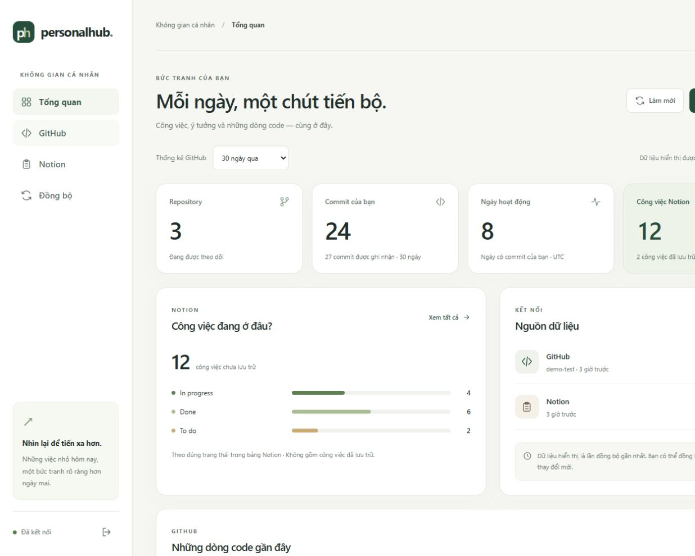
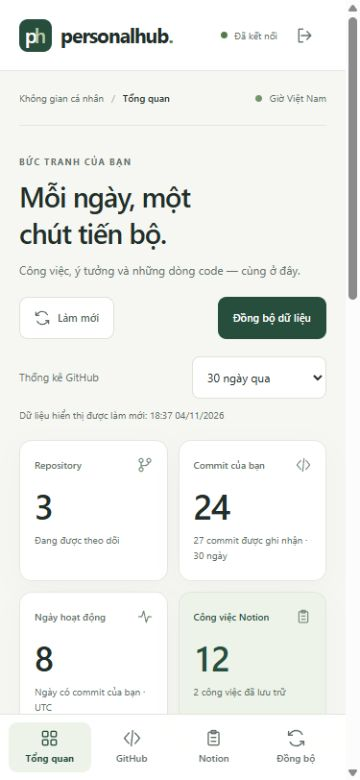

# Sử dụng dashboard PersonalHub

## Mở giao diện

Ứng dụng hiện đã chạy trên máy. Mở **[http://localhost:8080/dashboard](http://localhost:8080/dashboard)**, nhập **PERSONALHUB_API_KEY** trong `.env` và chọn **Kết nối không gian**. Đây là cùng khóa `apiKey` bạn đã dùng trong Postman.

Để chạy từ source mới trên máy khác, điền `.env` theo README rồi chạy:

```text
docker compose up -d --build
```

Dashboard đi cùng Spring Boot, dùng HTML/CSS/JavaScript modules có sẵn trong JAR. Không cần chạy dịch vụ frontend riêng hoặc cài Node để chạy ứng dụng Docker. Node 24 dùng cho các test client và server dữ liệu giả lập khi phát triển.

## Bốn phần chính

| Phần | Sử dụng |
| --- | --- |
| Tổng quan | Repository, commit của bạn, ngày hoạt động GitHub, số công việc Notion và biểu đồ trạng thái |
| GitHub | Xem repository, lọc commit theo repository, chuyển trang commit |
| Notion | Xem công việc, lọc đúng tên trạng thái, chọn gồm bản ghi đã lưu trữ và chuyển trang |
| Đồng bộ | Trigger từng nguồn, theo dõi GitHub đang chạy và xem tối đa 20 lượt gần nhất theo nguồn |

**Làm mới** đọc lại dữ liệu đã lưu trong PersonalHub. **Đồng bộ dữ liệu** đưa bạn đến màn hình chọn nguồn; nút Đồng bộ GitHub/Notion mới gửi yêu cầu lấy thay đổi từ nguồn.

Khoảng 7/30/90/365 ngày chỉ điều chỉnh thống kê GitHub. Danh sách commit là cache đã lưu, có phân trang; danh sách Notion không lọc theo khoảng này. Số ngày hoạt động GitHub tính theo UTC. Ngày giờ còn lại hiển thị theo Việt Nam; giá trị Date chỉ có ngày của Notion được giữ đúng ngày gốc.

Trạng thái công việc hiển thị theo tên trong bảng Notion, không suy luận tiến độ từ tên Done/To do hoặc coi cột Date là deadline. Các nhóm trong biểu đồ chỉ tính bản ghi chưa archived. Bộ lọc trạng thái lấy từ nhóm hiện có và các task đã tải; trạng thái chỉ xuất hiện trong các bản ghi archived chưa được tải có thể chưa nằm trong danh sách lựa chọn.

## Đồng bộ và lỗi

- GitHub nhận job rồi giao diện đọc trạng thái khoảng 2 giây/lần tới khi hoàn tất. Sau khoảng 4 phút, polling tự dừng và hướng dẫn dùng Làm mới; không đánh dấu job FAILED chỉ vì đã chờ lâu.
- Notion chạy trong request. Có thể chọn **Đọc lại toàn bộ bảng** nếu muốn bỏ qua checkpoint. Giao diện chờ tối đa 120 giây; nếu hết thời gian chờ, job phía server vẫn có thể tiếp tục. Dùng Làm mới/lịch sử để đối chiếu trước khi thử lại.
- Client không tự gửi lại POST khi lỗi mạng hoặc timeout. Các nút được khóa trong lúc đang gửi/đang thấy nguồn xử lý. Guard/locking phía server tiếp tục bảo vệ đồng bộ đồng thời.
- Chọn **Nguồn** trong lịch sử để xem GitHub hoặc Notion. Số đã xử lý bao gồm cả bản ghi đã có, không phải số bản ghi mới.
- Lỗi hiển thị thông báo an toàn và mã request khi có. Lịch sử có mã run để đối chiếu với endpoint/log hiện có. Xem [hướng dẫn Request ID](DASHBOARD_OVERVIEW_VI.md).
- Notion tắt hoặc cache chưa có dữ liệu có thông báo riêng; GitHub tiếp tục dùng được độc lập.

## Khóa truy cập và nội dung nguồn

Khóa chỉ được giữ trong bộ nhớ của tab, không ghi vào localStorage, sessionStorage, cookie hoặc URL. Ô nhập được xóa sau khi gửi. **Ngắt kết nối** xóa dữ liệu đang hiển thị và khóa trong tab; tải lại/rời trang cần kết nối lại. Lỗi 401 cũng đưa giao diện về màn hình kết nối.

Trang HTML và các asset giao diện là public; API dữ liệu/sync vẫn yêu cầu X-API-Key. Source không chèn key hoặc token vào HTML/JavaScript. Browser gọi cùng origin, bỏ cookie và không đi theo redirect. CSP chỉ cho script/style/kết nối cùng origin, chặn submit form thông thường và frame; giao diện không dùng CDN hay font bên ngoài.

Nội dung title/status/message được đưa vào DOM bằng textContent. Liên kết ngoài chỉ nhận HTTPS trên domain GitHub/Notion được cho phép; liên kết có user/password, domain giả mạo hoặc javascript: bị loại bỏ. Token upstream vẫn chỉ nằm ở backend.

PersonalHub tiếp tục dùng một API instance/database. Giao diện này phục vụ mô hình cá nhân dùng API key hiện có; OAuth, nhiều người dùng và metrics lưu lịch sử còn ở backlog.

## Ảnh xem trước

Các ảnh sau sử dụng **dữ liệu giả lập**, không phải dữ liệu cá nhân của người dùng.





## Phát triển và kiểm tra

```text
mvn -B verify
node --test src/test/frontend/dashboard-core.test.mjs
```

Java verify cần JDK 21 và Docker/PostgreSQL test; test client dùng Node 24, không cần npm install. CI có job dashboard-tests riêng, chưa có lượt GitHub Actions mới do source chưa push.

Để xem giao diện với dữ liệu giả lập, chạy `node src/test/frontend/preview-server.mjs`, mở `http://127.0.0.1:18080/dashboard`, dùng khóa giả `dashboard-test-only-key`. Server này chỉ nằm trong src/test, không đọc `.env`, không forward API thật và không vào JAR. Nó đã được dừng sau QA. Chỉ dùng cho phát triển; ứng dụng thật ở cổng 8080 dùng khóa của bạn.

[Kết quả xác minh](DASHBOARD_UI_VERIFICATION.md) · [Checklist thực hành](checklists/PERSONALHUB_LIVE_CHECKLIST_VI.md)
